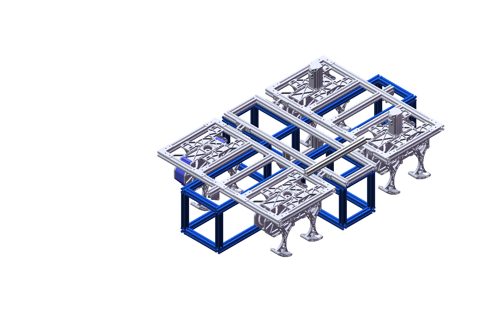
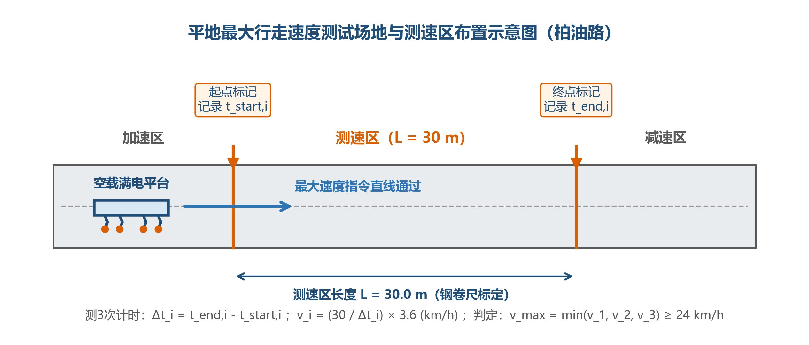
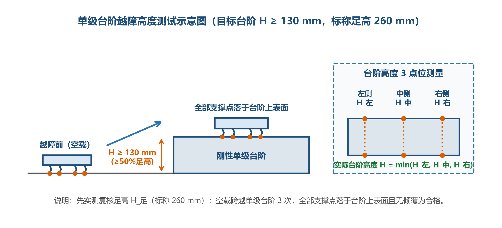
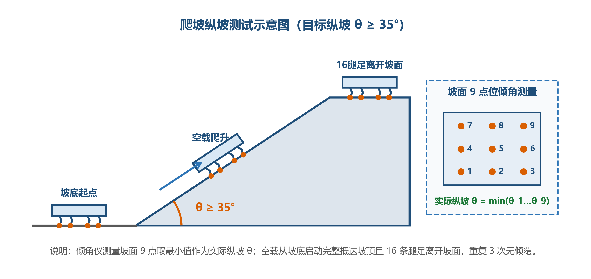
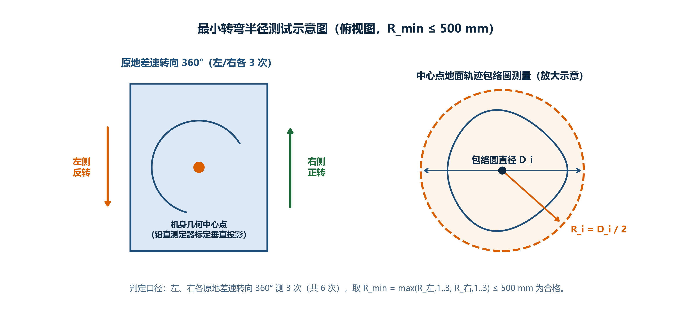
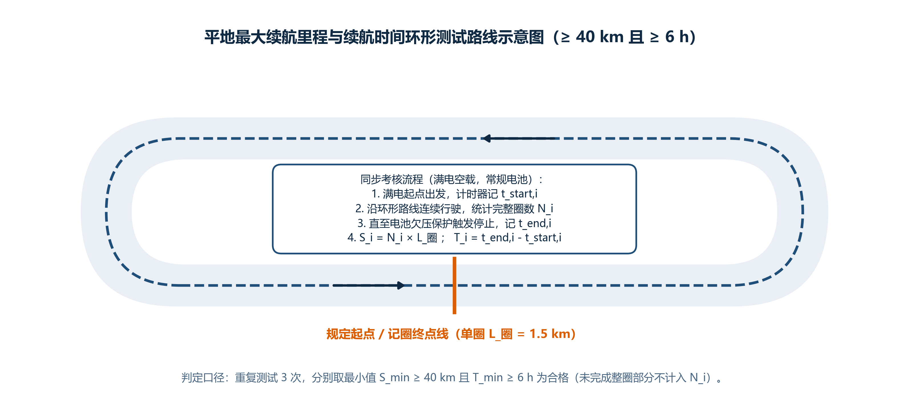

# 《面向高机动无人系统XXX技术研究》技术测试大纲

## 1. 概述

- **项目名称**：面向高机动无人系统XXX技术研究
- **项目编码**：M26GY0200020（总项目编码：K26GY0200010）
- **任务来源**：红果园国家级“科工局”
- **立项批复文号**：无 ⚠️

### 1.1 测试目的

本大纲用于指导《面向高机动无人系统XXX技术研究》项目的测试，对研制成果“高机动多足机器人原理样机”⚠️（以下简称：平台）的功能指标与技术指标进行实物测试和评定，判断平台是否达到合同及任务书规定的相关目标或指标，为项目验收提供依据。

### 1.2 测试依据

1. 《面向高机动无人系统XXX技术研究项目合同》
2. GB/T 44251-2024《腿式机器人性能及试验方法》 ⚠️
3. GB/T 38124-2019《服务机器人性能测试方法》 ⚠️
4. GB/T 47231-2026《工业重载移动机器人性能要求及测试方法》 ⚠️

### 1.3 工作原理与系统组成

平台采用前后双单元闭链多足俯仰行走构型，通过无刷电机经行星减速器与换向齿轮组驱动闭链多足行走机构实现高机动行进，并通过前后单元间的电动俯仰推杆调节整机俯仰姿态以适应越障与爬坡工况；转向时通过左右侧反向驱动实现原地差速转向。

平台主要由以下模块组成：

1. **闭链多足行走机构模块**：共 16 条腿（前后各 2 组单元，每组单元左右各 2 条腿），标称足高 260 mm；
2. **机身框架与俯仰连接模块**：3030 铝型材驱动框架、连接框架及电动俯仰推杆；
3. **动力与驱动模块**：4 台 C6374（170 KV、有感）无刷外转子电机、4 台 60 行星减速机、换向齿轮组及 4 只 120A 电调；
4. **运动控制与能源模块**：ESP32 运动控制器、遥控接收机及动力电池（⚠️）。

平台外形包络尺寸约为 1337.29 mm（长）× 850.00 mm（宽）× 472.94 mm（高），三维结构示意图见图 1。

*图 1 平台三维结构示意图*

---

## 2. 测试条件

### 2.1 测试单位与任务分工

| 序号 | 单位名称 | 承担的工作和任务 | 备注 |
| --- | --- | --- | --- |
| 1 | 北京交通大学机械与电子控制工程学院 | 负责高机动多足机器人原理样机提供、操作调试及性能指标测试配合 | |
| 2 | 北京交通大学计算机科学与技术学院 | 负责总项目统筹及系统联调配合 | |
| 3 | ⚠️ | 负责测试监督、数据记录与结果判定 | |

### 2.2 测试时间与地点

- **a）质量测试（≤ 40 kg）**：时间 ⚠️；地点 ⚠️。
- **b）载重测试（≥ 50 kg）**：时间 ⚠️；地点 ⚠️。
- **c）平地最大行走速度测试（≥ 24 km/h）**：时间 ⚠️；地点 ⚠️。
- **d）单级台阶越障高度测试（≥ 50% 足高，即 ≥ 130 mm）**：时间 ⚠️；地点 ⚠️。
- **e）爬坡测试（≥ 35°）**：时间 ⚠️；地点 ⚠️。
- **f）转弯半径测试（≤ 500 mm）**：时间 ⚠️；地点 ⚠️。
- **g）平地最大续航时间与最大续航里程测试（≥ 6 h 且 ≥ 40 km）**：时间 ⚠️；地点 ⚠️。

### 2.3 环境条件

- **环境温度**：⚠️
- **相对湿度**：⚠️
- **供电电源**：平台自带常规配置动力电池（⚠️）

---

## 3. 测试设备

表 1 测试设备清单

| 序号 | 测试设备名称 | 参考型号 | 主要技术要求 | 用途 | 检定或校准周期 |
| --- | --- | --- | --- | --- | --- |
| 1 | 电子秤 / 地磅 | ⚠️ | ⚠️ | 测量平台整机质量及标准载荷质量 | ⚠️ |
| 2 | 钢卷尺 | ⚠️ | ⚠️ | 测量足高、台阶高度、30 m 测速区、转弯直径、环形路线长度 | ⚠️ |
| 3 | 倾角仪 | ⚠️ | ⚠️ | 测量爬坡纵坡角度 | ⚠️ |
| 4 | 计时器 | ⚠️ | ⚠️ | 测量 30 m 测速区通过时间及续航时间 | ⚠️ |
| 5 | 万用表 | ⚠️ | ⚠️ | 测量电池端电压、核查欠压保护状态 | ⚠️ |

---

## 4. 被测研究成果和陪试品

### 4.1 被测成果

| 名称 | 数量 | 提供单位 | 构成情况 |
| --- | --- | --- | --- |
| 高机动多足机器人原理样机 ⚠️ | 1 台 | 北京交通大学机械与电子控制工程学院 | 由闭链 16 足行走机构、3030 铝型材框架与俯仰推杆模块、4 套 C6374 电机+60 行星减速机+120A 电调驱动模块、ESP32 运动控制模块及动力电池组成 |

### 4.2 陪试品

- 标准配重载荷（⚠️）
- 刚性单级台阶障碍（高度 ≥ 130 mm）、纵坡坡道装置（角度 ≥ 35°）

---

## 5. 测试项目的方法和步骤

### 5.1 测试项目、功能或指标、测试方法汇总表

| 类别 | 项目或参数 | 指标要求 | 测试依据 | 测试方式 | 备注 |
| --- | --- | --- | --- | --- | --- |
| 技术指标 | 质量 | ≤ 40 kg | 满电整备状态下，采用电子秤直接称量整机自身质量 | 室内静态称重 3 次，取算术平均值 | |
| 技术指标 | 载重 | ≥ 50 kg | 电子秤称量标准载荷并固定于承载区，检验承载静置与行走稳定性 | 静态加载并连续行走规定时长，重复 3 次均无形变与倾覆 | |
| 技术指标 | 平地最大行走速度 | ≥ 24 km/h | 固定距离测速法：测量平台以最大速度指令通过 30 m 测速区的平均速度 | 室外平坦柏油路，钢卷尺+计时器测 3 次，取最小值 | |
| 技术指标 | 单级台阶越障高度 | ≥ 50% 足高（≥ 130 mm） | 标称足高 260 mm，搭建 ≥ 130 mm 单级台阶检验攀爬越障能力 | 空载跨越单级台阶 3 次，全部支撑点落于台阶上表面且无倾覆 | |
| 技术指标 | 爬坡 | ≥ 35° | 倾角仪多点标定纵坡坡度，检验平台爬坡攀登能力 | 空载由坡底爬升至全部腿足离开坡面，重复 3 次无倾覆、无滑落 | |
| 技术指标 | 转弯半径 | ≤ 500 mm | 左右侧反向驱动原地差速转向，以机身几何中心点地面投影为参考点测轨迹包络圆半径 | 左、右各原地转向 360° 测 3 次，取 6 次最大值 | |
| 技术指标 | 平地最大续航时间 | ≥ 6 h | 常规电池满电空载按规定环形路线连续行驶至欠压保护触发，记录总运行时间 | 同次续航试验同步记录，重复 3 次取最小值 | 与里程同测 |
| 技术指标 | 平地最大续航里程 | ≥ 40 km | 常规电池满电空载沿标定环形路线连续行驶至欠压保护触发，按完整圈数计里程 | 同次续航试验同步记录，重复 3 次取最小值 | 与时间同测 |

### 5.2 技术指标测量方法和步骤

#### 5.2.1 质量测试

- **测试目的**：检验平台整机质量 ≤ 40 kg 指标的达成情况。
- **测试原理与场地**：在室内平坦硬化水泥地面开展测试；平台处于满电整备、无外加载荷的完整工作状态，使用电子秤直接称量整机质量，连续独立称量 3 次取算术平均值。
- **测试步骤与数据处理**：
  1. 确认平台处于完整工作配置，清除表面泥水及无关杂物；
  2. 将电子秤置于水平硬化地面并调零；
  3. 将平台平稳放置于称重台面中央，待示数稳定后记录整机质量 $m_i$（kg）；
  4. 移下平台待电子秤归零后重新称量，重复开展 3 次测试；
  5. 计算算术平均值：$m = \frac{1}{3} \sum_{i=1}^{3} m_i$。
- **合格判据**：平台整机质量 $m \le 40\text{ kg}$，判定合格。

#### 5.2.2 载重测试

- **测试目的**：检验平台最大有效载重 ≥ 50 kg 指标的达成情况。
- **测试原理与场地**：在室内平坦硬化水泥地面开展测试；使用电子秤称量标准载荷并稳固安装于平台承载区，在满电状态下依次检验静置与承载连续行走期间的结构稳定性及抗倾覆能力，重复 3 次。
- **测试步骤与数据处理**：
  1. 将平台置于室内平坦水泥地面，确认动力电池满电、控制系统运行正常；
  2. 使用电子秤称量标准载荷（⚠️），记录实际总载荷 $M_i$（kg），确保 $M_i \ge 50\text{ kg}$；
  3. 将载荷稳固固定于平台躯干承载区域（⚠️），静置观察平台无明显结构形变或倾覆；
  4. 启动平台以正常行走模式连续运行 ⚠️，观察并记录行走过程中是否发生倾覆、卡滞或结构损坏；
  5. 卸除载荷并检查平台状态后，重复上述步骤共开展 3 次测试；
  6. 计算 3 次载荷平均值：$M_{\text{load}} = \frac{1}{3} \sum_{i=1}^{3} M_i$。
- **合格判据**：3 次测试中平台承载静置及连续行走均无明显结构形变或倾覆，且平均总载荷 $M_{\text{load}} \ge 50\text{ kg}$，判定合格。

#### 5.2.3 平地最大行走速度测试

- **测试目的**：检验平台平地最大行走速度 ≥ 24 km/h 指标的达成情况。
- **测试原理与场地**：采用固定距离测速方法。在室外平坦柏油路直线布设加速区、长度 $L = 30\text{ m}$ 的测速区与减速区（见图 2）；平台在满电空载状态下以遥控最大速度指令穿过测速区，使用计时器记录平台同一固定参考点通过起点和终点的时刻 $t_{\text{start},i}$、$t_{\text{end},i}$，计算单次平均速度 $v_i$，共测 3 次并取最小值作为平台平地最大行走速度。

*图 2 平地最大行走速度测试场地与测速区布置示意图*

- **测试步骤与数据处理**：
  1. 将平台置于室外平坦柏油路测试场地，确认电池满电、控制系统运行正常；
  2. 使用钢卷尺标定直线跑道，设置足够长的加速区与减速区，并在中间测速区布设起点和终点标记（测速区长度 $L = 30\text{ m}$）；
  3. 平台处于空载状态，从加速区起点出发并给出最大速度指令，使其以最高稳定速度沿直线穿过 30 m 测速区；
  4. 使用计时器记录平台同一固定参考点通过测速区起点的时刻 $t_{\text{start},i}$ 与终点的时刻 $t_{\text{end},i}$；
  5. 在相同场地及测试条件下重复步骤 3）~4），共开展 3 次测试；
  6. 计算第 $i$ 次通过耗时（s）：$\Delta t_i = t_{\text{end},i} - t_{\text{start},i}$；
  7. 计算第 $i$ 次平均速度（km/h）：$v_i = \frac{30}{\Delta t_i} \times 3.6$；
  8. 取 3 次测试平均速度的最小值：$v_{\max} = \min(v_1, v_2, v_3)$。
- **合格判据**：平台平地最大行走速度 $v_{\max} \ge 24\text{ km/h}$，判定合格。

#### 5.2.4 单级台阶越障高度测试

- **测试目的**：检验平台单级台阶越障高度 ≥ 50% 足高（即 ≥ 130 mm）指标的达成情况。
- **测试原理与场地**：平台标称足高 $H_{\text{足}} = 260\text{ mm}$，50% 足高对应目标台阶高度为 130 mm。在平坦硬化地面搭建高度 ≥ 130 mm 的刚性单级台阶（见图 3），用钢卷尺对台阶左、中、右 3 点测高取最小值作为实际台阶高度 $H$。平台在空载状态下从预设起点接近并跨越台阶，观察全部支撑点是否均落于台阶上表面且无倾覆，共测 3 次。

*图 3 单级台阶越障高度测试示意图*

- **测试步骤与数据处理**：
  1. 平台置于水平地面处于标准工作站立姿态，使用钢卷尺实测复核样机足高 $H_{\text{足}}$（mm，标称 260 mm）；
  2. 搭建高度不低于 130 mm 的刚性单级台阶，用钢卷尺测量台阶左、中、右 3 个点位高度，取最小值作为实际台阶高度：$H = \min(H_{\text{左}}, H_{\text{中}}, H_{\text{右}})$；
  3. 将平台置于台阶前预设起点，确认电源充足、控制系统正常运行；
  4. 在空载状态下控制平台接近并跨越台阶，观察全部支撑点是否落于台阶上表面、过程是否发生倾覆；
  5. 重复步骤 3）~4），共开展 3 次测试，计算实际越障高度占足高比例：$\eta = \frac{H}{H_{\text{足}}} \times 100\%$。
- **合格判据**：3 次测试中平台全部支撑点均落于台阶上表面、过程无倾覆，且实际台阶高度 $H \ge 130\text{ mm}$（≥ 50% 足高），判定合格。

#### 5.2.5 爬坡测试

- **测试目的**：检验平台越障纵坡角度 ≥ 35° 指标的达成情况。
- **测试原理与场地**：搭建或选取固定纵坡障碍地形（见图 4），使用倾角仪对坡面 9 个点位测量坡度角并取最小值作为实际纵坡角度 $\theta$。平台在空载状态下从坡底起点启动，沿坡面向上爬升至完整抵达坡顶且 16 条腿足完全离开坡面区域，重复 3 次。

*图 4 爬坡纵坡测试示意图*

- **测试步骤与数据处理**：
  1. 使用倾角仪对纵坡坡面进行 9 个点位坡度测量，记录各测点倾角并取最小值：$\theta = \min(\theta_1, \theta_2, \dots, \theta_9)$；
  2. 将平台置于纵坡底部的预设起点，确认电源充足、控制系统正常运行；
  3. 在空载状态下控制平台启动爬坡，观察并记录平台是否完整抵达坡顶、16 条腿足是否完全离开坡面区域，以及攀爬过程中是否发生倾覆或失控滑落；
  4. 重复步骤 2）~3），共开展 3 次测试。
- **合格判据**：3 次测试中平台均完整抵达坡顶且 16 条腿足完全离开坡面区域、过程无倾覆，且实际纵坡角度 $\theta \ge 35^\circ$，判定合格。

#### 5.2.6 转弯半径测试

- **测试目的**：检验平台最小转弯半径 ≤ 500 mm 指标的达成情况。
- **测试原理与场地**：在平整硬化地面划定满足 360° 原地差速转向的测试区与中心点投影标定区（见图 5）。平台采用左右侧反向驱动实现原地差速转向，以平台机身几何中心点的地面垂直投影作为转弯轨迹参考点；在空载正常工作状态下分别向左、向右各完成 360° 原地转向，通过地面标定标记测量每次转向中心点轨迹包络圆的最大直径 $D_i$，折算转弯半径 $R_i = D_i / 2$。左右方向各测 3 次，取 6 次测次中的最大值作为平台实际转弯半径。

*图 5 原地差速转向转弯半径测试示意图*

- **测试步骤与数据处理**：
  1. 在平整硬化地面标定测试区域，确认平台供电正常、控制系统运行稳定；
  2. 在平台机身几何中心点对应底部位置安装地面垂直投影标记辅助装置；
  3. 给定左转原地差速转向指令，控制平台平稳完成 360° 原地转向，记录机身几何中心点地面轨迹；
  4. 使用钢卷尺测量该次轨迹包络圆的最大直径（至少测两对正交直径取最大值）$D_{\text{左},i}$（mm）；
  5. 重复步骤 3）~4）完成左转 3 次测试；再按相同方法完成右转 3 次测试，记录 $D_{\text{右},i}$（mm）；
  6. 计算每次转弯半径 $R_i = \frac{D_i}{2}$，取 6 次最大值：$R_{\min} = \max(R_{\text{左},1..3},\ R_{\text{右},1..3})$。
- **合格判据**：平台左右转向均平稳完成、无倾覆或机构卡滞，且测得的最小转弯半径 $R_{\min} \le 500\text{ mm}$，判定合格。

#### 5.2.7 平地最大续航时间与最大续航里程测试

- **测试目的**：检验平台平地最大续航时间 ≥ 6 h 及平地最大续航里程 ≥ 40 km 指标的达成情况。
- **测试原理与场地**：采用极限续航实测方法，同次试验同步考核续航时间与续航里程。在室外平坦环形路线（单圈里程 ⚠️，见图 6），平台装配常规动力电池（⚠️）充满电，在空载状态下连续行驶至电池欠压保护触发并停止行驶；使用计时器记录开始与结束时刻，并统计完整行驶圈数 $N_i$（最后一圈未完成部分不计入完整圈数），按单圈标定里程 $L_{\text{圈}}$ 计算总里程。每次测试前将电池充满电，共开展 3 次测试，分别取 3 次结果中的最小值作为平台平地续航时间和续航里程。

*图 6 平地最大续航时间与续航里程环形测试路线示意图*

- **测试步骤与数据处理**：
  1. 预先使用钢卷尺沿室外平坦环形测试路线中心线标定单圈总里程 $L_{\text{圈}}$（km，⚠️）；
  2. 检查平台装配常规动力电池且已充满电（万用表核对满电端电压），驱动与控制系统正常，置于规定起点；
  3. 启动平台连续行驶，同步使用计时器记录测试开始时间 $t_{\text{start},i}$；
  4. 在空载状态下操控平台按规定环形路线连续行驶，直至电池欠压保护触发并停止行驶，记录结束时间 $t_{\text{end},i}$ 及完整行驶圈数 $N_i$；
  5. 将电池重新充满电，重复步骤 2）~4），共开展 3 次测试；
  6. 计算第 $i$ 次续航时间：$T_i = t_{\text{end},i} - t_{\text{start},i}$；
  7. 计算第 $i$ 次续航里程：$S_i = N_i \times L_{\text{圈}}$；
  8. 分别取 3 次结果最小值：$T_{\min} = \min(T_1, T_2, T_3)$，$S_{\min} = \min(S_1, S_2, S_3)$。
- **合格判据**：
  1. 平台平地续航时间 $T_{\min} \ge 6\text{ h}$，判定续航时间指标合格；
  2. 平台平地续航里程 $S_{\min} \ge 40\text{ km}$，判定续航里程指标合格。

---

## 6. 有关问题说明

### 6.1 采用标准与自编规范

- **采用的标准**：GB/T 44251-2024、GB/T 38124-2019、GB/T 47231-2026 ⚠️
- **单位自编规范**：⚠️

### 6.2 一般要求、质量控制与安全要求

1. **一般要求**：测试大纲审批完整；参试样机、陪试品及测量设备状态满足要求；现场严格按测试记录表详实记录日期、状态、原始数据及异常事项。
2. **质量控制**：测试实行统一指挥，确保原始记录准确、完整、清晰、可追溯；技术状态更改须履行审批手续。
3. **安全要求**：制定安全应急预案并设安全监督员，严禁带影响安全的故障进行测试；高速测速、重载、爬坡及长时续航科目须划定安全警戒区，非相关人员远离测试区域。

### 6.3 终止测试和恢复测试的说明

- **终止测试**：测试中出现人员安全隐患、样机结构异常、失控或电源异常等情况，应立即停止测试、保护现场并报告现场指挥，查清原因前不得继续。
- **恢复测试**：故障排除或技术状态确认后，需经现场相关人员讨论评估并履行批准手续，方可按原大纲规定条件恢复测试或重新开展该测次。

---

## 7. 测试记录

### 7.1 测试结果汇总表

| 序号 | 技术指标要求 | 测试结果 | 测试结论 | 专家签名 |
| --- | --- | --- | --- | --- |
| 1 | 质量 ≤ 40 kg | | 合格 / 不合格 | |
| 2 | 载重 ≥ 50 kg | | 合格 / 不合格 | |
| 3 | 平地最大行走速度 ≥ 24 km/h | | 合格 / 不合格 | |
| 4 | 单级台阶越障高度 ≥ 50% 足高（≥ 130 mm） | | 合格 / 不合格 | |
| 5 | 爬坡 ≥ 35° | | 合格 / 不合格 | |
| 6 | 转弯半径 ≤ 500 mm | | 合格 / 不合格 | |
| 7 | 平地最大续航时间 ≥ 6 h | | 合格 / 不合格 | |
| 8 | 平地最大续航里程 ≥ 40 km | | 合格 / 不合格 | |

### 7.2 分项原始测试记录表

#### 附表 1：质量测试记录表

| 项目 | 内容 | 项目 | 内容 |
| --- | --- | --- | --- |
| 测试日期 | | 指标要求 | 质量 ≤ 40 kg |
| 测试设备 | 电子秤 / 地磅 | 测试对象 | 高机动多足机器人原理样机 ⚠️ |

| 测试次数 | 第 1 次 | 第 2 次 | 第 3 次 | 算术平均值 (kg) |
| --- | --- | --- | --- | --- |
| 整机质量读数 (kg) | | | | |

| 项目 | 内容 | 项目 | 内容 |
| --- | --- | --- | --- |
| 最终结果 (kg) | | 达标情况 | 合格 / 不合格 |
| 记录人员 | | 核对人员 | |

---

#### 附表 2：载重测试记录表

| 项目 | 内容 | 项目 | 内容 |
| --- | --- | --- | --- |
| 测试日期 | | 指标要求 | 载重 ≥ 50 kg |
| 测试设备 | 电子秤、标准载荷 | 测试对象 | 高机动多足机器人原理样机 ⚠️ |

| 测试次数 | 第 1 次 | 第 2 次 | 第 3 次 | 平均值 (kg) |
| --- | --- | --- | --- | --- |
| 实测载荷质量 (kg) | | | | |
| 静置是否出现明显形变或倾覆 | | | | — |
| 连续行走期间是否出现倾覆/异常 | | | | — |

| 项目 | 内容 | 项目 | 内容 |
| --- | --- | --- | --- |
| 最终结果 (kg) | | 达标情况 | 合格 / 不合格 |
| 记录人员 | | 核对人员 | |

---

#### 附表 3：平地最大行走速度测试记录表

| 项目 | 内容 | 项目 | 内容 |
| --- | --- | --- | --- |
| 测试日期 | | 指标要求 | 平地最大行走速度 ≥ 24 km/h |
| 测试设备 | 钢卷尺、计时器 | 测试对象 | 高机动多足机器人原理样机 ⚠️ |
| 测试路面 | 室外平坦柏油路 | 测速区长度 | 30 m |

| 测试次数 | 测速区长度 $L$ (m) | 起点时刻 $t_{\text{start}}$ (s) | 终点时刻 $t_{\text{end}}$ (s) | 耗时 $\Delta t$ (s) | 平均速度 (km/h) |
| --- | --- | --- | --- | --- | --- |
| 第 1 次 | 30 | | | | |
| 第 2 次 | 30 | | | | |
| 第 3 次 | 30 | | | | |

| 项目 | 内容 | 项目 | 内容 |
| --- | --- | --- | --- |
| 最终速度（最小值）(km/h) | | 达标情况 | 合格 / 不合格 |
| 记录人员 | | 核对人员 | |

---

#### 附表 4：单级台阶越障高度测试记录表

| 项目 | 内容 | 项目 | 内容 |
| --- | --- | --- | --- |
| 测试日期 | | 指标要求 | 越障 ≥ 50% 足高（≥ 130 mm） |
| 测试设备 | 钢卷尺 | 测试对象 | 高机动多足机器人原理样机 ⚠️ |
| 实测样机足高 $H_{\text{足}}$ (mm) | （标称 260 mm） | 目标最低台阶高度 (mm) | 130 |

| 台阶测高点位 | 左侧 | 中侧 | 右侧 | 实际台阶高度（最小值）(mm) |
| --- | --- | --- | --- | --- |
| 测量值 (mm) | | | | |

| 测试次数 | 第 1 次 | 第 2 次 | 第 3 次 |
| --- | --- | --- | --- |
| 全部支撑点是否落于台阶上表面 | | | |
| 越障过程是否发生倾覆/卡滞 | | | |

| 项目 | 内容 | 项目 | 内容 |
| --- | --- | --- | --- |
| 最终结果（台阶高度 / 足高占比） | | 达标情况 | 合格 / 不合格 |
| 记录人员 | | 核对人员 | |

---

#### 附表 5：爬坡测试记录表

| 项目 | 内容 | 项目 | 内容 |
| --- | --- | --- | --- |
| 测试日期 | | 指标要求 | 爬坡 ≥ 35° |
| 测试设备 | 倾角仪 | 测试对象 | 高机动多足机器人原理样机 ⚠️ |

| 坡度测点编号 | 1 | 2 | 3 | 4 | 5 | 6 | 7 | 8 | 9 | 实际纵坡（最小值）(°) |
| --- | --- | --- | --- | --- | --- | --- | --- | --- | --- | --- |
| 倾角读数 (°) | | | | | | | | | | |

| 测试次数 | 第 1 次 | 第 2 次 | 第 3 次 |
| --- | --- | --- | --- |
| 是否完整抵达坡顶且 16 条腿足离开坡面 | | | |
| 攀爬过程是否发生倾覆/滑落 | | | |

| 项目 | 内容 | 项目 | 内容 |
| --- | --- | --- | --- |
| 最终纵坡角度 (°) | | 达标情况 | 合格 / 不合格 |
| 记录人员 | | 核对人员 | |

---

#### 附表 6：转弯半径测试记录表

| 项目 | 内容 | 项目 | 内容 |
| --- | --- | --- | --- |
| 测试日期 | | 指标要求 | 转弯半径 ≤ 500 mm |
| 测试设备 | 钢卷尺 | 测试对象 | 高机动多足机器人原理样机 ⚠️ |
| 参考点与转向方式 | 机身几何中心点，原地差速转向 360° | — | — |

| 转向方向 | 测试次数 | 轨迹圆直径 $D$ (mm) | 转弯半径 $R = D/2$ (mm) | 运行状态说明 |
| --- | --- | --- | --- | --- |
| 左转 | 第 1 次 | | | |
| 左转 | 第 2 次 | | | |
| 左转 | 第 3 次 | | | |
| 右转 | 第 1 次 | | | |
| 右转 | 第 2 次 | | | |
| 右转 | 第 3 次 | | | |

| 项目 | 内容 | 项目 | 内容 |
| --- | --- | --- | --- |
| 最终转弯半径（最大值）(mm) | | 达标情况 | 合格 / 不合格 |
| 记录人员 | | 核对人员 | |

---

#### 附表 7：平地最大续航时间与最大续航里程测试记录表

| 项目 | 内容 | 项目 | 内容 |
| --- | --- | --- | --- |
| 测试日期 | | 指标要求 | 续航时间 ≥ 6 h；续航里程 ≥ 40 km |
| 测试设备 | 钢卷尺、计时器、万用表 | 测试对象 | 高机动多足机器人原理样机 ⚠️ |
| 单圈标定里程 $L_{\text{圈}}$ (km) | ⚠️ | 线路地点 | ⚠️ |

| 测试次数 | 初始电池电压 (V) | 开始时间 | 结束时间（欠压停机） | 完整行驶圈数 $N_i$ | 续航时间 $T_i$ (h) | 续航里程 $S_i$ (km) | 异常说明 |
| --- | --- | --- | --- | --- | --- | --- | --- |
| 第 1 次（i=1） | | | | | | | |
| 第 2 次（i=2） | | | | | | | |
| 第 3 次（i=3） | | | | | | | |

| 项目 | 内容 | 项目 | 内容 |
| --- | --- | --- | --- |
| 最终续航时间（最小值）(h) | | 最终续航里程（最小值）(km) | |
| 达标情况 | 合格 / 不合格 | 记录 / 核对人员 | |
