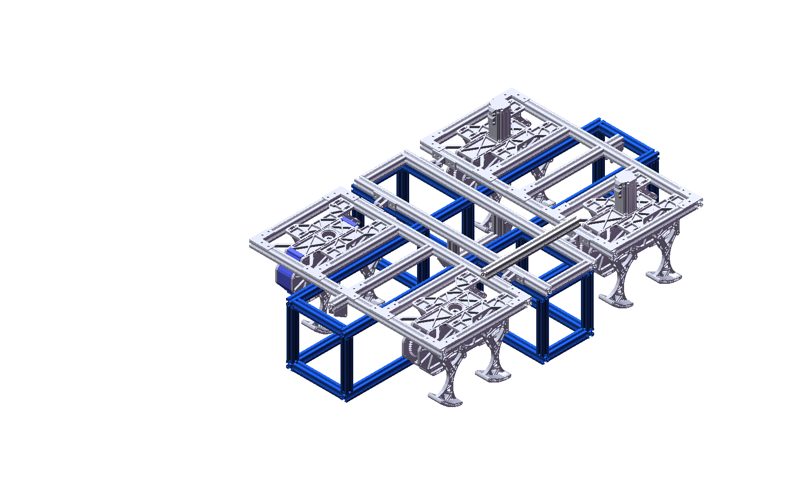
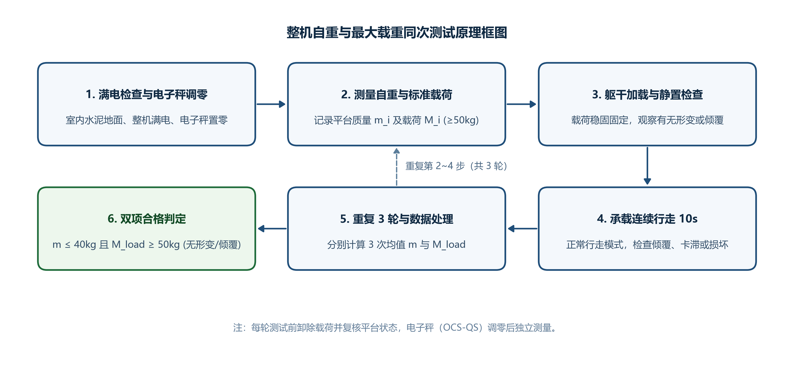
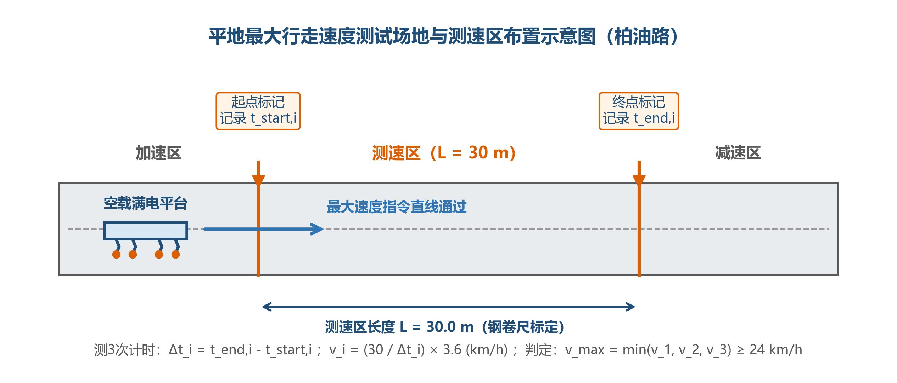
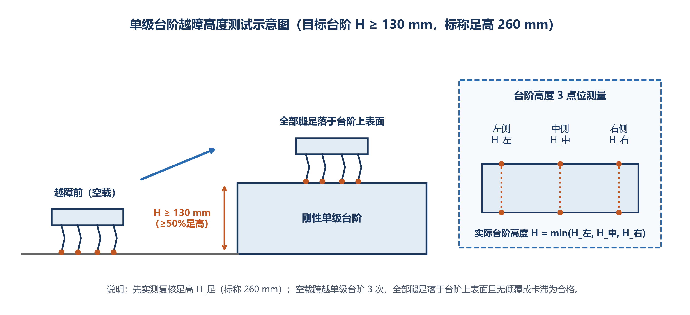
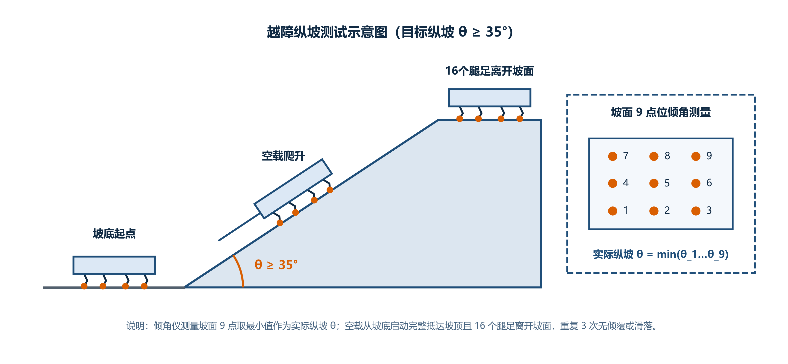
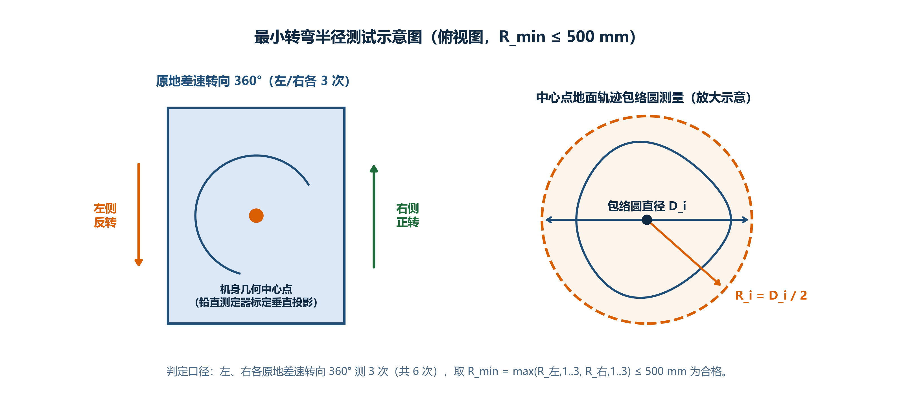
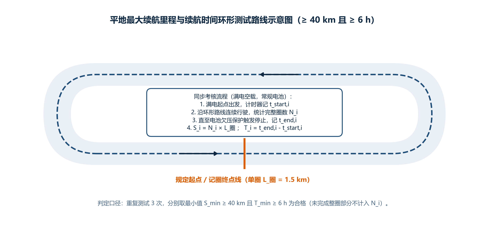

# 《面向高机动无人系统XXX技术研究》技术测试大纲

## 1. 概述

项目名称：面向高机动无人系统XXX技术研究

任务来源：红果园国家级“科工局”

立项批复文号：无 ⚠️

### 1.1 测试目的

本大纲用于指导《面向高机动无人系统XXX技术研究》项目的测试，对研制成果“高机动多足机器人原理样机”⚠️（以下简称：平台）的技术指标进行实物测试和评定，判断平台是否达到合同及任务书规定的相关目标或指标，为项目验收提供依据。

### 1.2 测试依据

测试依据的标准如下：

（1）《面向高机动无人系统XXX技术研究项目合同》

（2）GB/T 44251-2024《腿式机器人性能及试验方法》

（3）GB/T 38124-2019《服务机器人性能测试方法》

### 1.3 工作原理与系统组成

平台采用前后双单元闭链多足俯仰行走构型，通过无刷电机经行星减速器与换向齿轮组驱动闭链多足行走机构实现高机动行进，并通过前后单元间的电动俯仰推杆调节整机俯仰姿态以适应越障与爬坡工况；转向时通过左右侧反向驱动实现原地差速转向。

平台主体采用铝合金材料加工制作而成，主要由以下模块组成，如表1所示。

表 1 平台系统模块组成

| 模块名称               | 主要组成                                     | 核心功能                             |
| ---------------------- | -------------------------------------------- | ------------------------------------ |
| 闭链多足行走机构模块   | 16个闭链腿足（标称足高260mm）                | 实现多足行进与复杂地形适应           |
| 机身框架与俯仰连接模块 | 驱动框架、连接框架、电动俯仰推杆             | 承担整机承载与前后单元俯仰姿态调节   |
| 动力与驱动模块         | 无刷电机、行星减速器、换向齿轮组、电子调速器 | 提供行进、越障、爬坡及差速转向驱动力 |
| 运动控制与能源模块     | 嵌入式运动控制器、遥控接收机、动力电池       | 负责运动控制、遥控通信及整机供电     |

平台外形包络尺寸约为1337mm（长）×850mm（宽）×473mm（高），三维结构示意图如图1所示。⚠️

*图 1 平台三维结构示意图*

---

## 2. 测试条件

### 2.1 测试单位与任务分工

各参试单位及任务分工见表2。

表 2 测试单位与任务分工

| 序号 | 单位名称                           | 承担的工作和任务                                             | 备注 |
| ---- | ---------------------------------- | ------------------------------------------------------------ | ---- |
| 1    | 北京交通大学机械与电子控制工程学院 | 负责高机动多足机器人原理样机提供、操作调试及性能指标测试配合 |      |
| 2    | ⚠️                               | 负责测试监督、数据记录与结果判定                             |      |

### 2.2 测试时间与地点

a）整机自重与最大载重测试（≤40kg且≥50kg）
时间：⚠️
地点：⚠️

b）平地最大行走速度测试（≥24km/h）
时间：⚠️
地点：⚠️

c）单级台阶越障高度测试（≥50%足高，即≥130mm）
时间：⚠️
地点：⚠️

d）越障纵坡测试（≥35°）
时间：⚠️
地点：⚠️

e）最小转弯半径测试（≤500mm）
时间：⚠️
地点：⚠️

f）平地最大续航里程与平地最大续航时间测试（≥40km且≥6h）
时间：⚠️
地点：⚠️

### 2.3 环境条件⚠️

a）环境温度：常温（5℃～35℃）；

b）相对湿度：不大于85%（无凝露）；

c）供电电源：平台自带常规配置动力电池；

d）场地与气象条件：室内平坦硬化水泥地面、室外平坦柏油路及环形测试路面、刚性单级台阶与纵坡障碍地形；室外测试应在无雨雪、风力平缓、地面干燥无积水的安全可控区域开展。

---

## 3. 测试设备

本测试所需主要测试设备见表3。

表 3 测试设备清单

| 序号 | 测试设备名称 | 参考型号   | 主要技术要求                                          | 用途                                                  | 检定有效期      |
| ---- | ------------ | ---------- | ----------------------------------------------------- | ----------------------------------------------------- | --------------- |
| 1    | 电子秤       | OCS-QS     | 总量程500kg，显示分度值0.1kg                          | 测量平台整机质量及标准载荷质量                        | 至2027年7月1日  |
| 2    | 钢卷尺       | DL9010B    | 总量程10m，2m内示值误差±0.2mm                        | 测量足高、台阶高度、30m测速区及转弯直径               | 至2027年5月30日 |
| 3    | 倾角仪       | DXL180     | 总量程180°，准确度±0.1°                            | 测量越障纵坡角度                                      | 至2027年3月10日 |
| 4    | 计时器       | HS-70W-1JH | 最大量程9h59m59s999ms，最高计时精度1/1000s            | 测量载重连续行走时间、30m测速区通过时间及续航时间     | 至2027年8月31日 |
| 5    | 万用表       | DT9205A    | 直流电压量程200mV/2V/20V/200V/1000V，精度±（0.8%+3） | 测量电池端电压、核查欠压保护状态                      | 至2028年6月15日 |

---

## 4. 被测研究成果与陪试品

### 4.1 被测成果

本次被测成果信息见表4。

表 4 被测成果清单

| 名称                          | 数量 | 提供单位                           | 构成情况                                                                                 |
| ----------------------------- | ---- | ---------------------------------- | ---------------------------------------------------------------------------------------- |
| 高机动多足机器人原理样机 ⚠️ | 1台  | 北京交通大学机械与电子控制工程学院 | 由闭链多足行走机构模块、机身框架与俯仰连接模块、动力与驱动模块、运动控制与能源模块等组成 |

### 4.2 陪试品

本次测试所需陪试品见表5。

表 5 陪试品清单

| 序号 | 陪试品名称       | 规格要求                       | 用途                   |
| ---- | ---------------- | ------------------------------ | ---------------------- |
| 1    | 标准配重载荷     | 总质量≥50kg（具体形式 ⚠️）  | 最大载重测试           |
| 2    | 刚性单级台阶障碍 | 高度≥130mm                    | 单级台阶越障高度测试   |
| 3    | 纵坡坡道装置     | 纵坡角度≥35°                 | 越障纵坡测试           |
| 4    | 称重起吊辅助装置 | 满足平台安全起吊称重需求       | 整机自重与最大载重测试 |
| 5    | 铅直测定器       | 满足机身参考点地面垂直投影标定 | 最小转弯半径测试       |

---

## 5. 测试方法与步骤

### 5.1 技术指标与测试方法汇总表

表 6 技术指标与测试方法汇总表

| 类别     | 测试项目         | 指标要求             | 测试依据                                                              | 测试方式                                                     | 备注       |
| -------- | ---------------- | -------------------- | --------------------------------------------------------------------- | ------------------------------------------------------------ | ---------- |
| 技术指标 | 整机自重         | ≤40kg               | 满电状态下以电子秤测量平台自身质量，取3次测量值的算术平均值           | 室内水泥地面静态称重3次，与最大载重同次测试                  | 与载重同测 |
| 技术指标 | 最大载重         | ≥50kg               | 满电状态下以电子秤测量标准载荷质量并固定于承载区，取3次载荷算术平均值 | 室内水泥地面静置并连续行走10s，重复3次无明显形变与倾覆       | 与自重同测 |
| 技术指标 | 平地最大行走速度 | ≥24km/h             | 固定距离测速法：测定平台通过30m测速区的耗时并计算平均速度             | 室外平坦柏油路，采用钢卷尺与计时器测量3次，取最小值          |            |
| 技术指标 | 单级台阶越障高度 | ≥50%足高（≥130mm） | 标称足高260mm，以单级台阶3点测高最小值作为实际越障高度                | 空载跨越≥130mm单级台阶3次，全部腿足落于台阶上表面且无倾覆或卡滞 |            |
| 技术指标 | 越障纵坡         | ≥35°               | 以倾角仪对坡面9点测角的最小值作为实际纵坡角度                         | 空载由坡底攀升至16个腿足完全离开坡面，重复3次无倾覆或滑落      |            |
| 技术指标 | 最小转弯半径     | ≤500mm              | 原地差速转向，以机身几何中心点地面垂直投影轨迹包络圆直径计算转弯半径  | 空载左、右各原地转向360°测量3次，取6次最大值                  |            |
| 技术指标 | 平地最大续航里程 | ≥40km               | 满电空载沿1.5km环形路线连续行驶至欠压保护触发，按完整圈数计算里程     | 同次续航试验同步记录，重复3次取最小值                        | 与时间同测 |
| 技术指标 | 平地最大续航时间 | ≥6h                 | 满电空载沿1.5km环形路线连续行驶至欠压保护触发，以起止时间差计算时长   | 同次续航试验同步记录，重复3次取最小值                        | 与里程同测 |

### 5.2 技术指标测试方法与步骤

#### 5.2.1 整机自重与最大载重测试

（1）测试目的

检验平台整机自重≤40kg及最大载重≥50kg指标的完成情况。

（2）测试原理与场地

在室内平坦硬化水泥地面开展测试，同次试验同步考核整机自重与最大载重（如图2所示）。在满电状态下使用电子秤分别测量平台自身质量与标准载荷质量，通过承载静置及连续行走10s检验结构稳定性与抗倾覆能力，共开展3轮测试并取算术平均值。

*图 2 整机自重与最大载重测试原理框图*

（3）测试步骤

1）确认平台处于完整工作配置、动力电池满电且控制系统运行正常，置于室内平坦水泥地面；

2）挂装称重起吊辅助装置后将电子秤调零（若采用台秤则直接调零），测量平台自身质量，待示数稳定后记录读数 $m_i$（kg）；

3）使用电子秤测量标准载荷（⚠️），待示数稳定后记录实际总载荷 $M_i$（kg），确保 $M_i \ge 50\text{kg}$；

4）将标准载荷稳固固定于平台躯干承载区域（⚠️），静置观察平台是否出现明显结构形变或倾覆；

5）启动平台以正常行走模式连续运行，使用计时器计时不少于10s，观察并记录行走过程中是否发生倾覆、卡滞或结构损坏；

6）卸除载荷并检查平台状态后，重复步骤2）至5），共开展3次测试。

（4）数据处理

1）计算3次平台自身质量测量值的算术平均值作为整机自重：

$$
m = \frac{1}{3} \sum_{i=1}^{3} m_i
$$

2）计算3次标准载荷测量值的算术平均值作为平均总载荷：

$$
M_{\text{load}} = \frac{1}{3} \sum_{i=1}^{3} M_i
$$

（5）合格判据

1）平台整机质量 $m \le 40\text{kg}$，判定整机自重指标合格；

2）3次测试中平台承载静置及连续行走均无明显结构形变、倾覆、卡滞或结构损坏，且平均总载荷 $M_{\text{load}} \ge 50\text{kg}$，判定最大载重指标合格。

#### 5.2.2 平地最大行走速度测试

（1）测试目的

检验平台平地最大行走速度≥24km/h指标的完成情况。

（2）测试原理与场地

采用固定距离测速方法，在室外平坦柏油路直线布设加速区、长度 $L = 30\text{m}$ 的测速区与减速区（如图3所示）。平台在满电空载状态下以最大速度指令穿过测速区，由计时器测定通过耗时并计算平均速度，共开展3次测试并取最小值作为平地最大行走速度。

*图 3 平地最大行走速度测试场地与测速区布置示意图*

（3）测试步骤

1）将平台置于室外平坦柏油路测试场地，确认电池满电、控制系统运行正常；

2）使用钢卷尺标定直线跑道，设置足够长的加速区与减速区，并在中间测速区布设起点和终点标记（测速区长度 $L = 30\text{m}$）；

3）平台处于空载状态，从加速区起点出发并给出最大速度指令，使其以最高稳定速度沿直线穿过30m测速区；

4）使用计时器记录平台同一固定参考点通过测速区起点的时刻 $t_{\text{start},i}$ 与终点的时刻 $t_{\text{end},i}$；

5）在相同场地及测试条件下重复步骤3）至4），共开展3次测试。

（4）数据处理

1）计算第 $i$ 次通过耗时（s）：

$$
\Delta t_i = t_{\text{end},i} - t_{\text{start},i}
$$

2）计算第 $i$ 次平均速度（km/h，其中 $L = 30\text{m}$）：

$$
v_i = \frac{L}{\Delta t_i} \times 3.6
$$

3）取3次测试平均速度的最小值作为平台平地最大行走速度：

$$
v_{\max} = \min(v_1, v_2, v_3)
$$

（5）合格判据

平台平地最大行走速度 $v_{\max} \ge 24\text{km/h}$，判定平地最大行走速度指标合格。

#### 5.2.3 单级台阶越障高度测试

（1）测试目的

检验平台单级台阶越障高度≥50%足高（即≥130mm）指标的完成情况。

（2）测试原理与场地

平台标称足高 $H_{\text{足}} = 260\text{mm}$，对应50%足高目标为130mm，在平坦硬化地面搭建高度≥130mm的刚性单级台阶（如图4所示）。以左、中、右3个点位测高的最小值作为实际台阶高度，检验平台空载跨越台阶时全部腿足落于台阶上表面且无倾覆或卡滞的能力，共开展3次测试。

*图 4 单级台阶越障高度测试示意图*

（3）测试步骤

1）平台置于水平地面处于标准工作站立姿态，使用钢卷尺实测复核样机足高 $H_{\text{足}}$（mm，标称260mm）；

2）搭建高度不低于130mm的刚性单级台阶，用钢卷尺测量台阶左、中、右3个点位高度；

3）将平台置于台阶前预设起点，确认电源充足、控制系统正常运行；

4）在空载状态下控制平台接近并跨越台阶，观察并记录全部腿足是否落于台阶上表面，以及越障过程是否发生倾覆或卡滞；

5）重复步骤3）至4），共开展3次测试。

（4）数据处理

1）取台阶左、中、右3个测点高度的最小值作为实际台阶高度：

$$
H = \min(H_{\text{左}}, H_{\text{中}}, H_{\text{右}})
$$

2）计算实际越障高度占足高比例：

$$
\eta = \frac{H}{H_{\text{足}}} \times 100\%
$$

（5）合格判据

3次测试中平台全部腿足均落于台阶上表面、过程无倾覆或卡滞，且实际台阶高度 $H \ge 130\text{mm}$、实测越障占比 $\eta \ge 50\%$，判定单级台阶越障高度指标合格。

#### 5.2.4 越障纵坡测试

（1）测试目的

检验平台越障纵坡角度≥35°指标的完成情况。

（2）测试原理与场地

搭建或选取固定纵坡障碍地形（如图5所示），使用倾角仪对坡面9个点位测角并取最小值作为实际纵坡角度。平台在空载状态下从坡底攀升至16个腿足完全离开坡面区域，检验其连续爬坡与抗倾覆滑落能力，共开展3次测试。

*图 5 越障纵坡测试示意图*

（3）测试步骤

1）沿纵坡坡面左、中、右三列及上、中、下三排均匀选取9个点位，使用倾角仪依次测量并记录各测点倾角 $\theta_1 \sim \theta_9$；

2）将平台置于纵坡底部的预设起点，确认电源充足、控制系统正常运行；

3）在空载状态下控制平台启动爬坡，观察并记录平台是否完整抵达坡顶、16个腿足是否完全离开坡面区域，以及攀爬过程中是否发生倾覆或失控滑落；

4）重复步骤2）至3），共开展3次测试。

（4）数据处理

取坡面9个测点倾角的最小值作为实际纵坡角度：

$$
\theta = \min(\theta_1, \theta_2, \dots, \theta_9)
$$

（5）合格判据

3次测试中平台均完整抵达坡顶且16个腿足完全离开坡面区域、过程无倾覆或滑落，且实际纵坡角度 $\theta \ge 35^\circ$，判定越障纵坡指标合格。

#### 5.2.5 最小转弯半径测试

（1）测试目的

检验平台最小转弯半径≤500mm指标的完成情况。

（2）测试原理与场地

在平整硬化地面划定满足360°原地差速转向的测试区与投影标定区（如图6所示）。平台在空载状态下采用左右侧反向驱动实现原地差速转向，以机身几何中心点的地面垂直投影轨迹包络圆直径计算转弯半径，左、右各测3次并取6次最大值作为实际转弯半径。

*图 6 最小转弯半径测试示意图*

（3）测试步骤

1）在平整硬化地面标定测试区域，确认平台供电正常、控制系统运行稳定；

2）采用铅直测定器标定平台机身几何中心点的地面垂直投影；

3）在空载状态下给定左转原地差速转向指令，控制平台平稳完成360°原地转向，观察转向过程有无倾覆或机构卡滞，并记录机身几何中心点地面轨迹；

4）使用钢卷尺测量该次轨迹包络圆的最大直径（至少测两对正交直径取最大值）$D_{\text{左},i}$（mm）；

5）重复步骤3）至4）完成左转3次测试；再按相同方法完成右转3次测试，记录 $D_{\text{右},i}$（mm）。

（4）数据处理

1）计算每次转弯半径（mm）：

$$
R_i = \frac{D_i}{2}
$$

2）取左、右共6次测量结果的最大值作为平台最小转弯半径：

$$
R_{\min} = \max(R_{\text{左},1..3},\ R_{\text{右},1..3})
$$

（5）合格判据

平台左右转向均平稳完成、无倾覆或机构卡滞，且测得的最小转弯半径 $R_{\min} \le 500\text{mm}$，判定最小转弯半径指标合格。

#### 5.2.6 平地最大续航里程与平地最大续航时间测试

（1）测试目的

检验平台平地最大续航里程≥40km及平地最大续航时间≥6h指标的完成情况。

（2）测试原理与场地

采用极限续航实测方法，同次试验同步考核续航里程与续航时间，测试场地为单圈里程1.5km的室外平坦环形路线（如图7所示）。平台在满电空载状态下连续行驶至电池欠压保护触发停止，按完整圈数与运行耗时分别计算里程和时间，共开展3次测试并取最小值。

*图 7 平地最大续航里程与续航时间环形测试路线示意图*

（3）测试步骤

1）选取已标定单圈总里程 $L_{\text{圈}} = 1.5\text{km}$ 的室外平坦环形测试路线，并明确起点位置；

2）检查平台装配常规动力电池且已充满电（使用万用表核对并记录初始端电压），确认驱动与控制系统正常，将平台置于规定起点；

3）启动平台连续行驶，同步使用计时器记录测试开始时间 $t_{\text{start},i}$；

4）在空载状态下操控平台按规定环形路线连续行驶（平台由起点出发沿路线完整返回起点计为1圈），直至电池欠压保护触发并停止行驶，记录结束时间 $t_{\text{end},i}$、完整行驶圈数 $N_i$（最后一圈未完成部分不计入完整圈数），并使用万用表复测终止电池端电压；

5）将电池重新充满电，重复步骤2）至4），共开展3次测试。

（4）数据处理

1）计算第 $i$ 次测试的续航里程（km）：

$$
S_i = N_i \times L_{\text{圈}}
$$

2）计算第 $i$ 次测试的续航时间（h）：

$$
T_i = t_{\text{end},i} - t_{\text{start},i}
$$

3）分别取3次测试结果的最小值作为平台平地续航里程和续航时间：

$$
S_{\min} = \min(S_1, S_2, S_3), \quad T_{\min} = \min(T_1, T_2, T_3)
$$

（5）合格判据

1）平台平地续航里程 $S_{\min} \ge 40\text{km}$，判定平地最大续航里程指标合格；

2）平台平地续航时间 $T_{\min} \ge 6\text{h}$，判定平地最大续航时间指标合格。

---

## 6. 有关问题说明

### 6.1 采用标准与自编规范

a）采用的标准：GB/T 44251-2024《腿式机器人性能及试验方法》、GB/T 38124-2019《服务机器人性能测试方法》；

b）单位自编规范：⚠️。

### 6.2 一般要求

a）测试大纲须履行完整审批手续后方可实施；

b）测试前严格检查参试样机、陪试品及测量设备的技术状态，确保满足测试要求；

c）参试人员须明确测试目的、岗位职责及观察要点，保持良好的测试秩序；

d）参试各方须按测试记录表详实记录测试日期、技术状态、原始数据及异常事项；

e）测试前须开展测试准备状态检查，经现场指挥确认后方可正式开始测试。

### 6.3 操作质量控制

a）测试实行统一指挥，操作人员严格按照指挥指令执行操作；

b）按规范填写分项原始测试记录表，确保记录数据准确、完整、清晰并具有可追溯性；

c）测试过程中如需更改样机技术状态，须按规定程序填写技术状态更改单并履行审批手续。

### 6.4 测试安全要求

a）测试现场设安全监督员并制定安全应急预案，明确应急处置分工；

b）当安全与测试进度发生冲突时，须优先保障安全，严禁带影响安全的故障开展测试；

c）测试设备及称重起吊辅助装置须由专人按操作规程使用，测前检查确认无异常；

d）平地最大行走速度、最大载重、越障纵坡及长时续航等高风险科目，须在外场或测试区划定安全警戒区并设置明显标识，非相关人员远离测试区域；

e）外场测试前须对测试路面、障碍地形及周边交通环境进行安全巡视，确认满足技术与安全需求；

f）承研单位负责按维护规范对原理样机及动力电池进行定期检查保养，及时排查机械松动、过热及电源隐患。

### 6.5 测试终止与恢复说明

a）终止测试：测试中出现人员安全隐患、样机结构或传动异常、遥控失控、电池过热或电源异常等情况时，应优先确保人员与场地安全，立即停止测试、保护现场并报告现场指挥，查清原因前不得继续测试；

b）恢复测试：故障排除或技术状态确认后，须经现场相关人员讨论评估并履行批准手续，方可按原大纲规定条件恢复测试或重新开展该测次；因排查故障需临时增加测试或操作时，须先行讨论拟定操作步骤并经审批后方可实施。

---

## 7. 测试记录

### 7.1 测试结果汇总表

表 7 测试结果汇总表

| 序号 | 技术指标要求                         | 测试结果 | 测试结论           | 专家签名 |
| ---- | ------------------------------------ | -------- | ------------------ | -------- |
| 1    | 整机自重≤40kg                       |          | □ 合格  □ 不合格 |          |
| 2    | 最大载重≥50kg                       |          | □ 合格  □ 不合格 |          |
| 3    | 平地最大行走速度≥24km/h             |          | □ 合格  □ 不合格 |          |
| 4    | 单级台阶越障高度≥50%足高（≥130mm） |          | □ 合格  □ 不合格 |          |
| 5    | 越障纵坡≥35°                       |          | □ 合格  □ 不合格 |          |
| 6    | 最小转弯半径≤500mm                  |          | □ 合格  □ 不合格 |          |
| 7    | 平地最大续航里程≥40km               |          | □ 合格  □ 不合格 |          |
| 8    | 平地最大续航时间≥6h                 |          | □ 合格  □ 不合格 |          |

### 7.2 分项原始测试记录表

#### 附表 1：整机自重与最大载重测试记录表

| 项目       | 内容                      | 项目     | 内容                           |
| ---------- | ------------------------- | -------- | ------------------------------ |
| 测试日期   |                           | 测试地点 |                                |
| 环境温湿度 | 温度：____℃  湿度：____% | 指标要求 | 整机自重≤40kg；最大载重≥50kg |
| 测试设备   | 电子秤、计时器            | 测试对象 | 高机动多足机器人原理样机 ⚠️  |

| 测试次数                                          | 第1次          | 第2次          | 第3次          | 算术平均值（kg） |
| ------------------------------------------------- | -------------- | -------------- | -------------- | ---------------- |
| 平台自身质量读数（kg）                            |                |                |                |                  |
| 实测载荷质量读数（kg）                            |                |                |                |                  |
| 静置是否出现明显形变或倾覆                        | □ 是  □ 否   | □ 是  □ 否   | □ 是  □ 否   | —               |
| 连续行走（不少于10s）期间是否出现倾覆、卡滞或损坏 | □ 是  □ 否   | □ 是  □ 否   | □ 是  □ 否   | —               |

| 项目                   | 内容               | 项目                   | 内容               |
| ---------------------- | ------------------ | ---------------------- | ------------------ |
| 整机自重最终结果（kg） |                    | 最大载重最终结果（kg） |                    |
| 整机自重达标情况       | □ 合格  □ 不合格 | 最大载重达标情况       | □ 合格  □ 不合格 |
| 记录人员               |                    | 核对人员               |                    |
| 备注                   |                    | —                     | —                 |

---

#### 附表 2：平地最大行走速度测试记录表

| 项目       | 内容                      | 项目       | 内容                          |
| ---------- | ------------------------- | ---------- | ----------------------------- |
| 测试日期   |                           | 测试地点   |                               |
| 环境温湿度 | 温度：____℃  湿度：____% | 指标要求   | 平地最大行走速度≥24km/h      |
| 测试设备   | 钢卷尺、计时器            | 测试对象   | 高机动多足机器人原理样机 ⚠️ |
| 测试路面   | 室外平坦柏油路            | 测速区长度 | 30m                           |

| 测试次数 | 测速区长度 $L$（m） | 起点时刻 $t_{\text{start}}$（s） | 终点时刻 $t_{\text{end}}$（s） | 耗时 $\Delta t$（s） | 平均速度（km/h） |
| -------- | --------------------- | ---------------------------------- | -------------------------------- | ---------------------- | ---------------- |
| 第1次    | 30                    |                                    |                                  |                        |                  |
| 第2次    | 30                    |                                    |                                  |                        |                  |
| 第3次    | 30                    |                                    |                                  |                        |                  |

| 项目                       | 内容 | 项目     | 内容               |
| -------------------------- | ---- | -------- | ------------------ |
| 最终速度（最小值）（km/h） |      | 达标情况 | □ 合格  □ 不合格 |
| 记录人员                   |      | 核对人员 |                    |
| 备注                       |      | —       | —                 |

---

#### 附表 3：单级台阶越障高度测试记录表

| 项目                               | 内容                       | 项目                   | 内容                                 |
| ---------------------------------- | -------------------------- | ---------------------- | ------------------------------------ |
| 测试日期                           |                            | 测试地点               |                                      |
| 环境温湿度                         | 温度：____℃  湿度：____%  | 指标要求               | 单级台阶越障高度≥50%足高（≥130mm） |
| 测试设备                           | 钢卷尺                     | 测试对象               | 高机动多足机器人原理样机 ⚠️        |
| 实测样机足高 $H_{\text{足}}$（mm） | 标称260，实测：____        | 目标最低台阶高度（mm） | 130                                  |

| 台阶测高点位 | 左侧 $H_{\text{左}}$ | 中侧 $H_{\text{中}}$ | 右侧 $H_{\text{右}}$ | 实际台阶高度 $H$（最小值）（mm） |
| ------------ | ---------------------- | ---------------------- | ---------------------- | -------------------------------- |
| 测量值（mm） |                        |                        |                        |                                  |

| 测试次数                   | 第1次        | 第2次        | 第3次        |
| -------------------------- | ------------ | ------------ | ------------ |
| 全部腿足是否落于台阶上表面 | □ 是  □ 否 | □ 是  □ 否 | □ 是  □ 否 |
| 越障过程是否发生倾覆或卡滞 | □ 是  □ 否 | □ 是  □ 否 | □ 是  □ 否 |

| 项目     | 内容                                         | 项目     | 内容               |
| -------- | -------------------------------------------- | -------- | ------------------ |
| 最终结果 | 台阶高度 $H$：____mm；越障占比 $\eta$：____% | 达标情况 | □ 合格  □ 不合格 |
| 记录人员 |                                              | 核对人员 |                    |
| 备注     |                                              | —       | —                 |

---

#### 附表 4：越障纵坡测试记录表

| 项目       | 内容                      | 项目     | 内容                          |
| ---------- | ------------------------- | -------- | ----------------------------- |
| 测试日期   |                           | 测试地点 |                               |
| 环境温湿度 | 温度：____℃  湿度：____% | 指标要求 | 越障纵坡≥35°                |
| 测试设备   | 倾角仪                    | 测试对象 | 高机动多足机器人原理样机 ⚠️ |

| 纵坡测点位置（°）          | 左侧 | 中侧 | 右侧 |
| --------------------------- | ---- | ---- | ---- |
| 上排（$\theta_1 \sim \theta_3$） |      |      |      |
| 中排（$\theta_4 \sim \theta_6$） |      |      |      |
| 下排（$\theta_7 \sim \theta_9$） |      |      |      |
| 实际纵坡（最小值）（°）    |      | —   | —   |

| 测试次数                           | 第1次        | 第2次        | 第3次        |
| ---------------------------------- | ------------ | ------------ | ------------ |
| 是否完整抵达坡顶且16个腿足离开坡面 | □ 是  □ 否 | □ 是  □ 否 | □ 是  □ 否 |
| 攀爬过程是否发生倾覆或滑落         | □ 是  □ 否 | □ 是  □ 否 | □ 是  □ 否 |

| 项目               | 内容 | 项目     | 内容               |
| ------------------ | ---- | -------- | ------------------ |
| 最终纵坡角度（°） |      | 达标情况 | □ 合格  □ 不合格 |
| 记录人员           |      | 核对人员 |                    |
| 备注               |      | —       | —                 |

---

#### 附表 5：最小转弯半径测试记录表

| 项目             | 内容                                    | 项目     | 内容                          |
| ---------------- | --------------------------------------- | -------- | ----------------------------- |
| 测试日期         |                                         | 测试地点 |                               |
| 环境温湿度       | 温度：____℃  湿度：____%               | 指标要求 | 最小转弯半径≤500mm           |
| 测试设备/陪试品  | 钢卷尺、铅直测定器                      | 测试对象 | 高机动多足机器人原理样机 ⚠️ |
| 参考点与转向方式 | 机身几何中心点，空载原地差速转向360°    | —       | —                            |

| 转向方向 | 测试次数 | 正交直径 $D_1$（mm） | 正交直径 $D_2$（mm） | 最大直径 $D$（mm） | 转弯半径 $R = D/2$（mm） | 是否倾覆或卡滞 |
| -------- | -------- | -------------------- | -------------------- | ------------------ | ------------------------ | -------------- |
| 左转     | 第1次    |                      |                      |                    |                          | □ 是  □ 否   |
| 左转     | 第2次    |                      |                      |                    |                          | □ 是  □ 否   |
| 左转     | 第3次    |                      |                      |                    |                          | □ 是  □ 否   |
| 右转     | 第1次    |                      |                      |                    |                          | □ 是  □ 否   |
| 右转     | 第2次    |                      |                      |                    |                          | □ 是  □ 否   |
| 右转     | 第3次    |                      |                      |                    |                          | □ 是  □ 否   |

| 项目                         | 内容 | 项目     | 内容               |
| ---------------------------- | ---- | -------- | ------------------ |
| 最终转弯半径（最大值）（mm） |      | 达标情况 | □ 合格  □ 不合格 |
| 记录人员                     |      | 核对人员 |                    |
| 备注                         |      | —       | —                 |

---

#### 附表 6：平地最大续航里程与平地最大续航时间测试记录表

| 项目                               | 内容                      | 项目     | 内容                          |
| ---------------------------------- | ------------------------- | -------- | ----------------------------- |
| 测试日期                           |                           | 测试地点 | ⚠️                          |
| 环境温湿度                         | 温度：____℃  湿度：____% | 指标要求 | 续航里程≥40km；续航时间≥6h  |
| 测试设备                           | 计时器、万用表            | 测试对象 | 高机动多足机器人原理样机 ⚠️ |
| 单圈标定里程 $L_{\text{圈}}$（km） | 1.5                       | 电池配置 | 常规动力电池                  |

| 测试次数 | 初始电池电压（V） | 开始时间 | 结束时间（欠压保护触发） | 终止电池电压（V） | 完整行驶圈数 $N_i$ | 续航里程 $S_i$（km） | 续航时间 $T_i$（h） |
| -------- | ----------------- | -------- | ------------------------ | ----------------- | -------------------- | ---------------------- | --------------------- |
| 第1次    |                   |          |                          |                   |                      |                        |                       |
| 第2次    |                   |          |                          |                   |                      |                        |                       |
| 第3次    |                   |          |                          |                   |                      |                        |                       |

| 项目                         | 内容               | 项目                        | 内容               |
| ---------------------------- | ------------------ | --------------------------- | ------------------ |
| 最终续航里程（最小值）（km） |                    | 最终续航时间（最小值）（h） |                    |
| 续航里程达标情况             | □ 合格  □ 不合格 | 续航时间达标情况            | □ 合格  □ 不合格 |
| 记录人员                     |                    | 核对人员                    |                    |
| 备注                         |                    | —                          | —                 |
